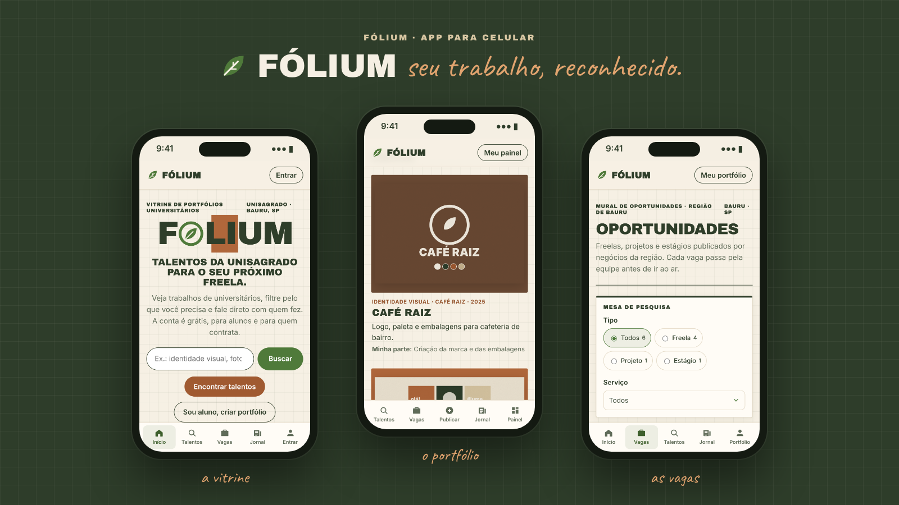
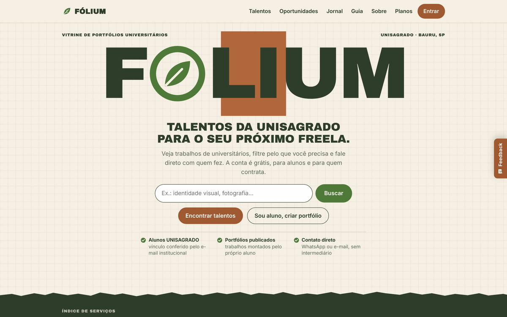
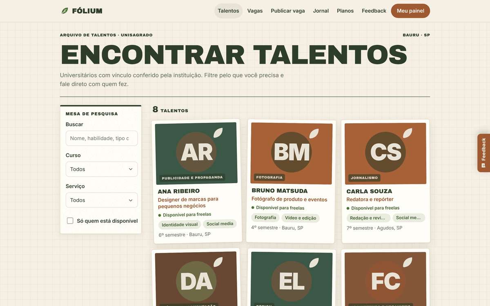
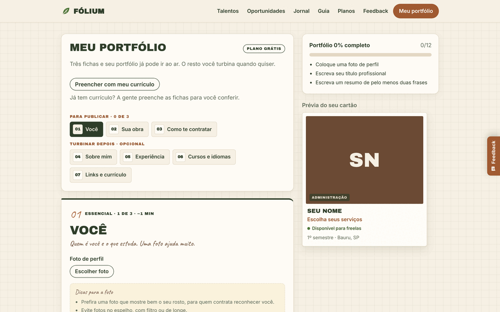
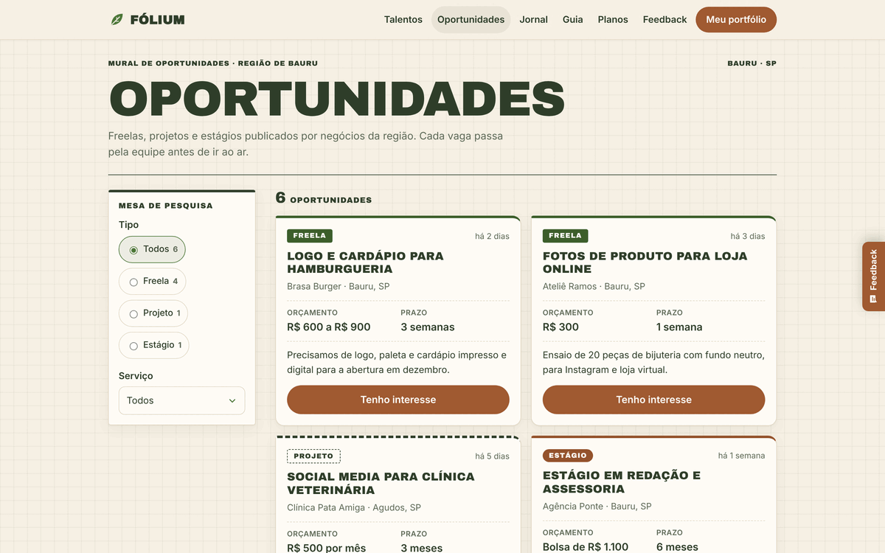
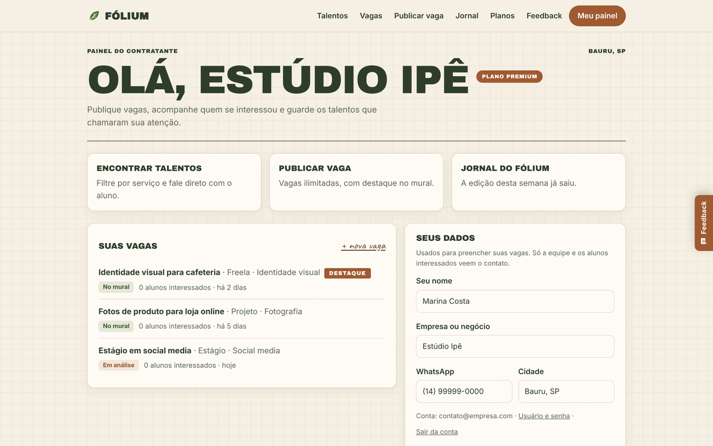

<div align="center">


# Fólium

**Seu trabalho, reconhecido.**

Vitrine de portfólios que conecta universitários da UNISAGRADO a negócios da região que procuram freelas, projetos e estágios.

[**Acessar o Fólium**](https://folium-phi.vercel.app) · [Sobre o projeto](#sobre-o-projeto) · [Funcionalidades](#funcionalidades) · [Rodar localmente](#rodar-localmente)


</div>

---

## Sobre o projeto

O Fólium nasceu na disciplina de Empreendedorismo da UNISAGRADO (Bauru, SP) como resposta a um problema simples: universitários já fazem trabalhos reais (identidade visual, fotografia, textos, sites, vídeos), mas não têm onde mostrá-los de um jeito que inspire confiança. Do outro lado, pequenos negócios da região querem contratar talento local e não sabem onde procurar.

A plataforma junta os dois lados:

- **O aluno** monta um portfólio com seus trabalhos, recebe um link próprio para mandar a clientes e ganha o selo de aluno verificado pela instituição.
- **Quem contrata** encontra talentos por curso e serviço, vê os trabalhos antes de conversar, publica vagas e fala direto com o aluno, sem intermediário e sem comissão.

O projeto começa na UNISAGRADO, em parceria com a instituição, e tem como visão ser um espaço seguro de vitrine e reconhecimento para universitários, expandindo depois para outros centros universitários da região.

**Equipe:** Eduarda Ferreira Corrêa, Giovana Buscariolo de Lima e Lauren Zareski de Oliveira.

<div align="center">

</div>

## Funcionalidades

| | |
| --- | --- |
| **Portfólio do aluno** | Editor com prévia ao vivo: trabalhos com galeria, experiências, certificados, idiomas, links e currículo (com importação de PDF). Link próprio para compartilhar. |
| **Busca de talentos** | Filtros por curso, serviço e disponibilidade. Só quem tem conta vê os perfis, para proteger os dados dos alunos. |
| **Mural de oportunidades** | Freelas, projetos e estágios publicados por negócios da região. O aluno demonstra interesse com um toque. |
| **Painel do contratante** | Acompanha as vagas publicadas, quem se interessou e os talentos salvos. |
| **Guia de preços** | Referência de quanto cobrar por serviço, com calculadora, e dicas de segurança para fechar um trabalho. |
| **Planos** | Grátis e Premium para alunos e contratantes, além de licença institucional. |
| **Jornal do Fólium** | Edição semanal com vagas, talentos em destaque e matérias para quem está começando. |
| **Tour guiado** | Apresenta o site na primeira visita, uma única vez por conta. |
| **Feedback e denúncias** | Aba de feedback em todas as páginas (que também chega por e-mail para a equipe) e denúncia de perfis, com limite contra abuso. |
| **App instalável (PWA)** | Funciona no navegador e pode ser instalado no celular ou no computador, sem loja de aplicativos. |

### Telas

<table>
  <tr>
    <td width="50%"><br><sub><b>Início</b></sub></td>
    <td width="50%"><br><sub><b>Busca de talentos</b></sub></td>
  </tr>
  <tr>
    <td><br><sub><b>Editor de portfólio</b></sub></td>
    <td><br><sub><b>Mural de oportunidades</b></sub></td>
  </tr>
  <tr>
    <td><br><sub><b>Painel do contratante</b></sub></td>
    <td><br><sub><b>Tour guiado</b></sub></td>
  </tr>
</table>

## Tecnologias

- **[Next.js 15](https://nextjs.org/) + React 19 + TypeScript**, exportado como site estático (`output: "export"`).
- **[Supabase](https://supabase.com/)**: autenticação, banco Postgres com Row Level Security e armazenamento de fotos e currículos.
- **[Vercel](https://vercel.com/)**: hospedagem e deploy automático.
- **PWA**: manifesto e service worker próprios para instalar o app.
- **Animações**: anime.js, ScrollReveal, Three.js e Lottie, seguindo as regras de [MOVIMENTO.md](MOVIMENTO.md).
- **Identidade visual**: paleta "folha + papel + terra" (verde-fólio, verde-musgo, castanho-café, marrom-cobre e creme-papel).

## Segurança e dados

- Cadastro de aluno só com e-mail institucional da UNISAGRADO.
- Primeiro acesso por link no e-mail; depois, entrada com usuário e senha forte.
- Regras de acesso direto no banco (RLS): cada pessoa só altera os próprios dados, e os perfis dos alunos só aparecem para quem tem conta.
- Nenhuma chave secreta fica no código ou no navegador; o front-end usa apenas a chave pública do Supabase.

## Rodar localmente

Precisa do [Node.js](https://nodejs.org/) 20 ou mais novo.

```bash
git clone https://github.com/theduds108/folium.git
cd folium
npm install
npm run dev
```

Abra http://localhost:3000.

Sem configurar nada, o site roda em **modo demonstração**, com dados de exemplo e sem salvar nada de verdade.

Para ligar o banco, o login e o envio de fotos, copie o arquivo de exemplo e preencha com os dados do seu projeto Supabase (Project Settings > API):

```bash
cp .env.local.example .env.local
```

O passo a passo completo, incluindo as migrações do banco, está em [SUPABASE.md](SUPABASE.md).

### Comandos

| Comando | O que faz |
| --- | --- |
| `npm run dev` | Servidor de desenvolvimento |
| `npm run build` | Gera a versão de produção (pasta `out/`) |
| `npm run lint` | Confere o código com o ESLint |

## Deploy

O Fólium está no ar em **https://folium-phi.vercel.app**.

A Vercel publica automaticamente a branch `develop` em produção a cada push. As variáveis `NEXT_PUBLIC_SUPABASE_URL` e `NEXT_PUBLIC_SUPABASE_ANON_KEY` ficam configuradas no painel da Vercel, nunca no repositório.

## Estrutura de pastas

```
folium/
├── app/                  # Páginas (App Router)
│   ├── page.tsx          # Início
│   ├── talentos/         # Busca de talentos
│   ├── perfil/           # Portfólio público (/perfil/?u=usuario)
│   ├── meu-perfil/       # Editor do portfólio
│   ├── oportunidades/    # Mural de vagas
│   ├── publicar/         # Publicar vaga
│   ├── painel/           # Painel do contratante
│   ├── guia/             # Guia de preços e segurança
│   ├── planos/           # Planos e preços
│   ├── jornal/           # Jornal do Fólium
│   ├── feedback/         # Feedback
│   ├── entrar/, senha/   # Login e senha
│   ├── instalar/         # Como instalar o app
│   └── globals.css       # Paleta e todo o visual
├── components/           # Componentes (cabeçalho, menu, tour, cartões, animações…)
├── lib/                  # Dados, regras e acesso ao Supabase
│   ├── config.ts         # Ajustes gerais (domínio institucional, exemplos, limites)
│   ├── conteudo.ts       # Textos, planos e recursos
│   ├── repositorio.ts    # Leituras e gravações no banco
│   └── sessao.ts         # Login e sessão
├── supabase/migrations/  # Tabelas e regras de segurança do banco
├── public/               # Ícones, service worker e animações Lottie
└── docs/imagens/         # Imagens deste README
```

## Fluxo de trabalho (git)

- `main`: versão estável.
- `develop`: onde entram as novidades e correções; é a branch publicada na Vercel.
- Cada mudança vem em uma branch própria e entra na `develop` por pull request.
- Mensagens de commit em português, com prefixo:
  - `FEAT | descrição` para funcionalidades novas
  - `FIX | descrição` para correções

## Próximos passos

- Domínio próprio.
- Painel de administração (hoje a aprovação de vagas e a análise de denúncias são feitas pelo painel do Supabase).
- Perfil em destaque nas buscas e estatísticas de visitas para o plano Premium.
- Expansão para outros centros universitários da região.

---

<div align="center">
<sub>Projeto de Empreendedorismo · UNISAGRADO · 2026</sub>
</div>
